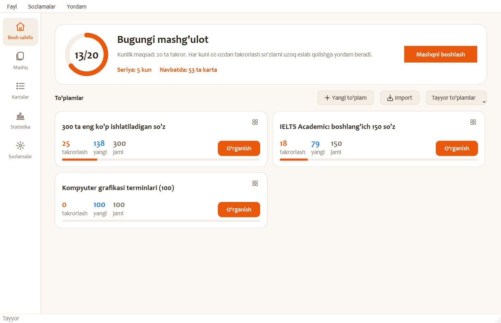
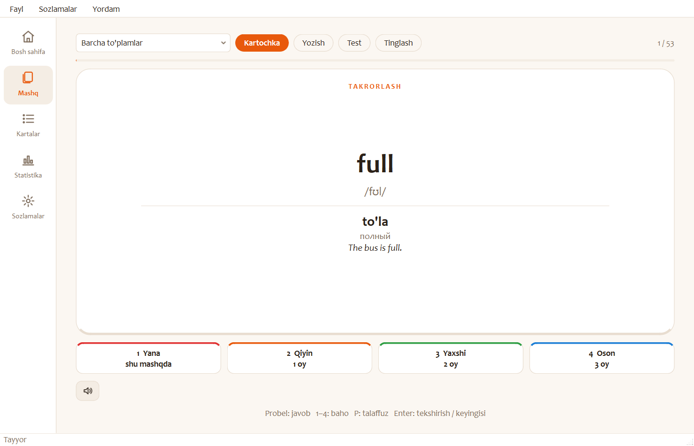
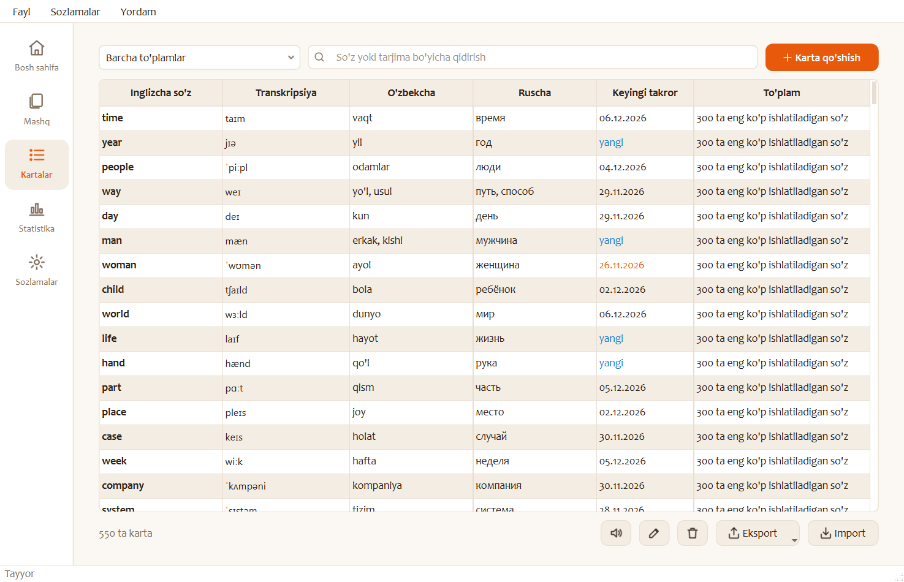
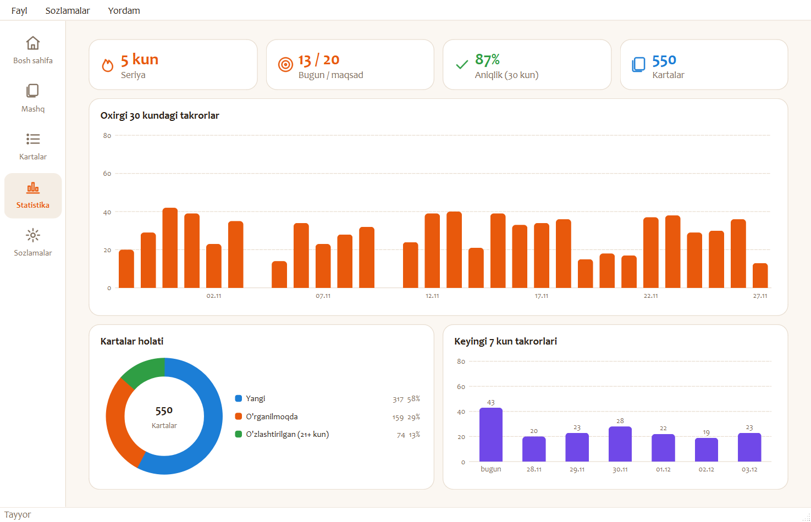
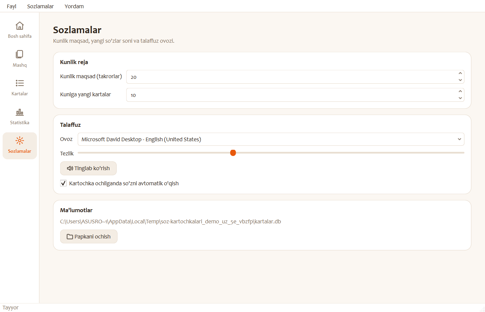
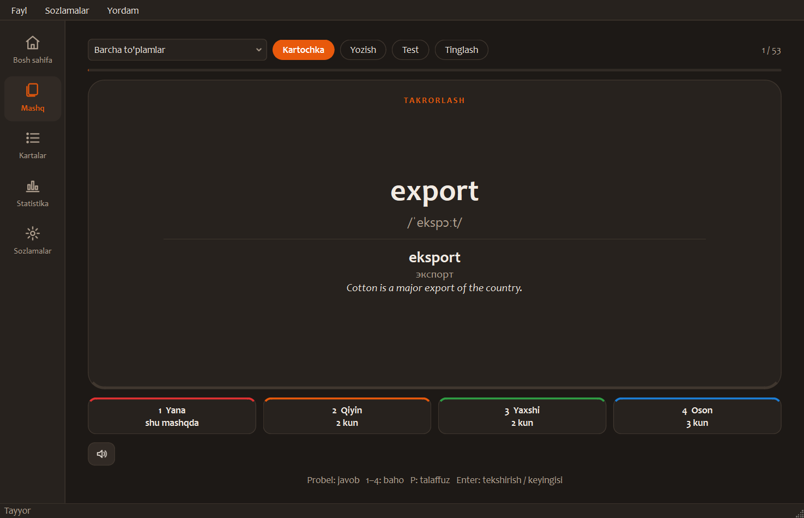

<h1 align="center">Inglizcha so'z kartochkalari</h1>

<b>English Flashcards</b> · Карточки английских слов

   
  
  
  
  

Inglizcha so'zlarni kartochkalar orqali yodlash dasturi: SM-2 takrorlash algoritmi, to'rt xil mashq (kartochka, yozish, test, tinglash), Windows ovozi bilan offline talaffuz, kunlik maqsad, seriya va statistika. 550 so'zli uchta tayyor to'plam bilan.

## Imkoniyatlar

- SM-2 takrorlash algoritmi: har bir so'z unutishdan oldin qaytariladi
- Mashq turlari: kartochka, yozib javob berish, 4 variantli test, tinglab yozish
- Windows SAPI orqali offline talaffuz
- Karta: so'z, transkripsiya, o'zbekcha va ruscha tarjima, misol, rasm
- Tayyor to'plamlar: 300 ta eng ko'p ishlatiladigan so'z, IELTS Academic 150 so'z, kompyuter grafikasi terminlari 100
- Kunlik maqsad, seriya, 30 kunlik va 7 kunlik grafiklar
- CSV, Excel va Anki TSV import/eksport
- Klaviatura: Probel, 1–4, P, Enter

## O'rnatish

1. [**SozKartochkalari.exe**](https://github.com/eduhakimov/soz-kartochkalari/releases/latest/download/SozKartochkalari.exe) faylini yuklab oling.
2. Faylni ishga tushiring, o'rnatish shart emas.
3. Windows SmartScreen ogohlantirsa: **Batafsil → Baribir ishga tushirish**.

**Tizim talablari:** Windows 10 (1809+) / Windows 11, x64

---

## Русский

Программа для запоминания английских слов по карточкам: алгоритм интервальных повторений SM-2, четыре режима (карточка, ввод, тест, аудирование), офлайн-произношение голосом Windows, дневная цель, серия и статистика. Три готовых набора на 550 слов.

- Алгоритм SM-2: слово повторяется до того, как забудется
- Режимы: карточка, ввод ответа, тест из 4 вариантов, аудирование
- Офлайн-произношение через Windows SAPI
- Карточка: слово, транскрипция, перевод на узбекский и русский, пример, картинка
- Готовые наборы: 300 частотных слов, IELTS Academic 150 слов, 100 терминов компьютерной графики
- Дневная цель, серия, графики за 30 и на 7 дней
- Импорт/экспорт CSV, Excel и Anki TSV
- Клавиатура: Пробел, 1–4, P, Enter

## English

Learn English words with flashcards: SM-2 spaced repetition, four study modes (flip, typing, multiple choice, listening), offline pronunciation with Windows voices, daily goal, streak and statistics. Ships with three decks totalling 550 words.

- SM-2 spaced repetition: each word comes back before you forget it
- Modes: flip card, typed answer, 4-option quiz, listening
- Offline pronunciation via Windows SAPI
- Card: word, IPA, Uzbek and Russian translation, example, image
- Built-in decks: 300 common words, IELTS Academic 150, 100 computer graphics terms
- Daily goal, streak, 30-day and 7-day charts
- CSV, Excel and Anki TSV import/export
- Keyboard: Space, 1–4, P, Enter

---

## Muallif / Author

**Bahtiyorjon Hakimov** (Hakimov Bahtiyorjon Muzaffar o'g'li), [github.com/eduhakimov](https://github.com/eduhakimov)

© 2026 Bahtiyorjon Hakimov. Barcha huquqlar himoyalangan. / Все права защищены. / All rights reserved.
Batafsil: [LICENSE](LICENSE) · Uchinchi tomon komponentlari: [THIRD_PARTY_NOTICES.md](THIRD_PARTY_NOTICES.md)
