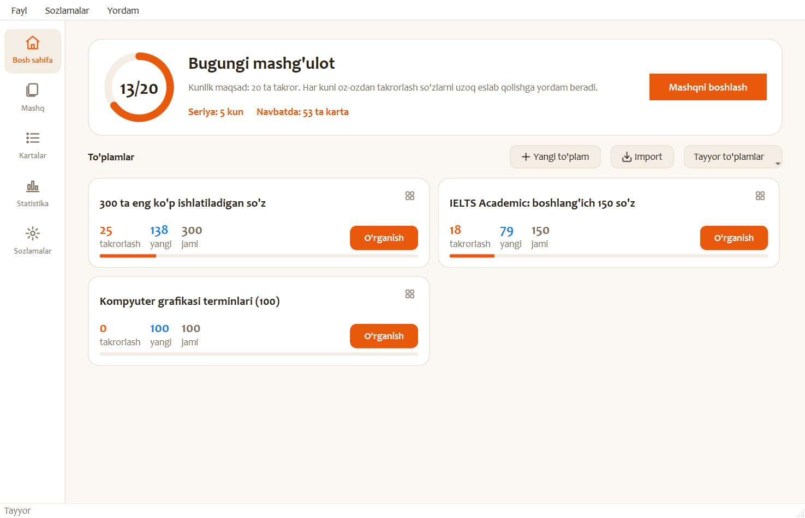
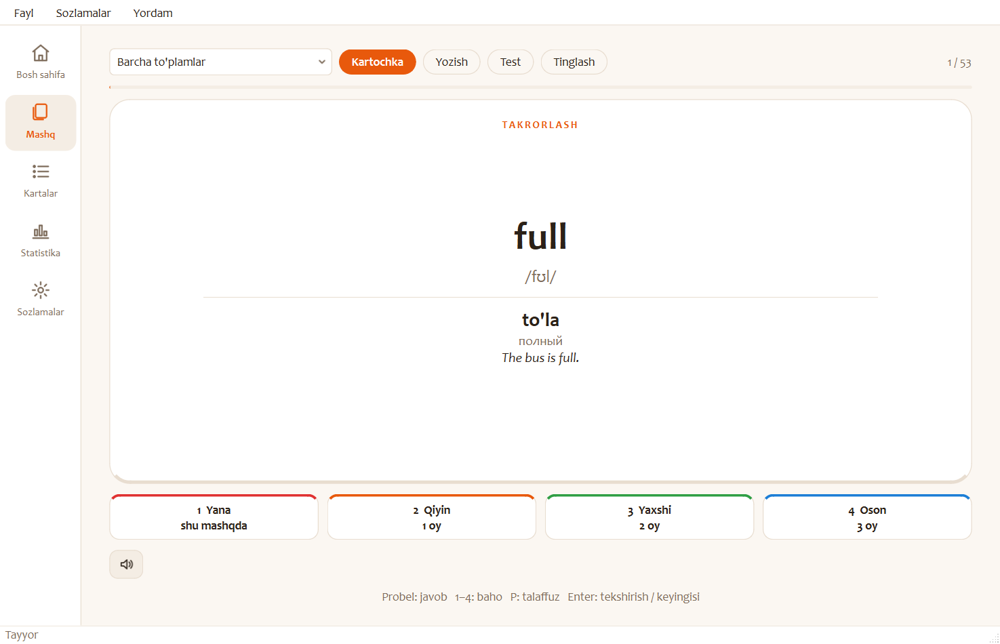
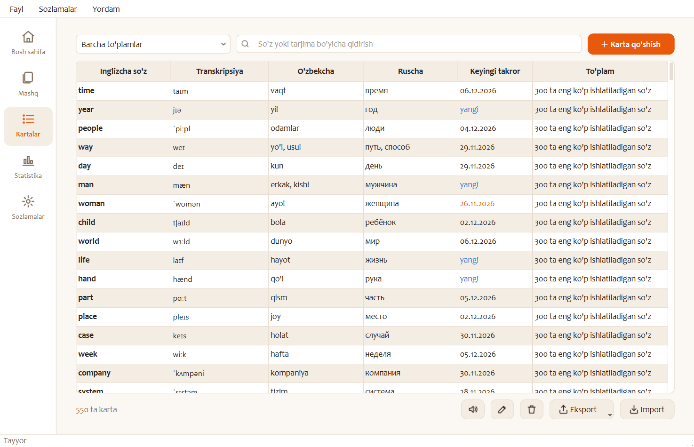
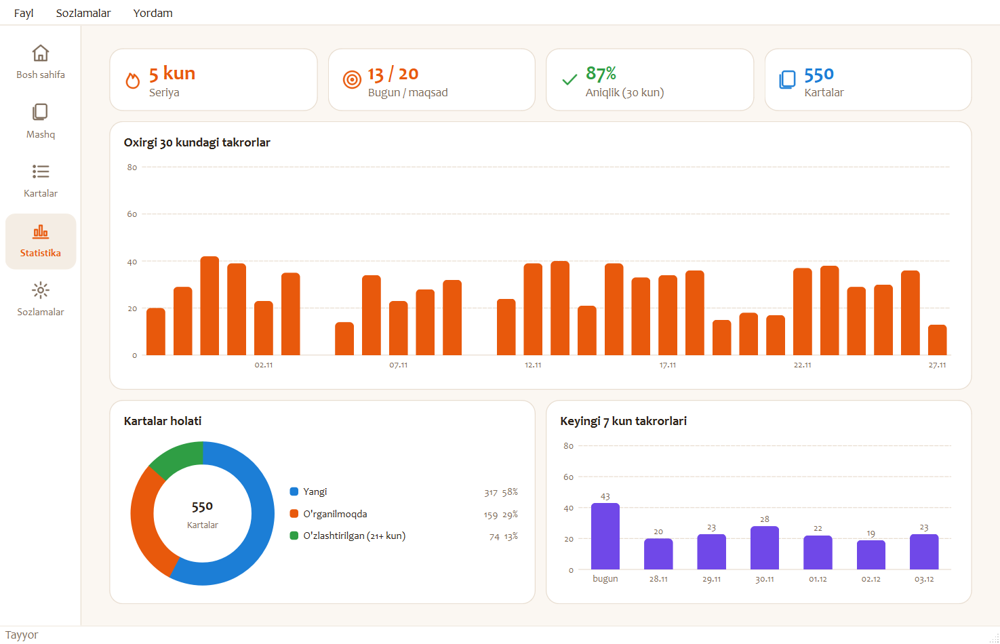
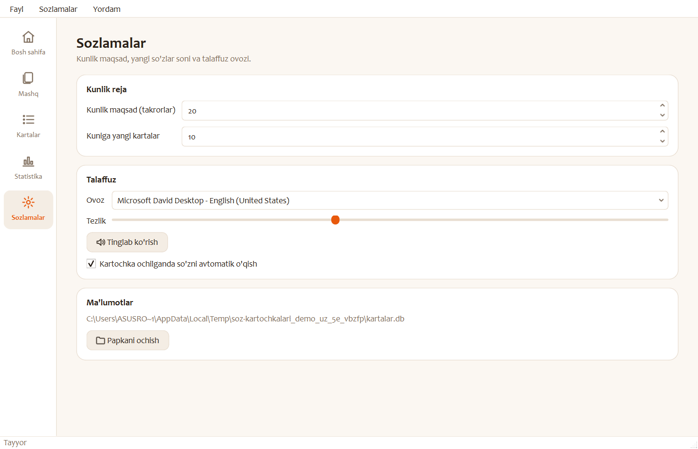
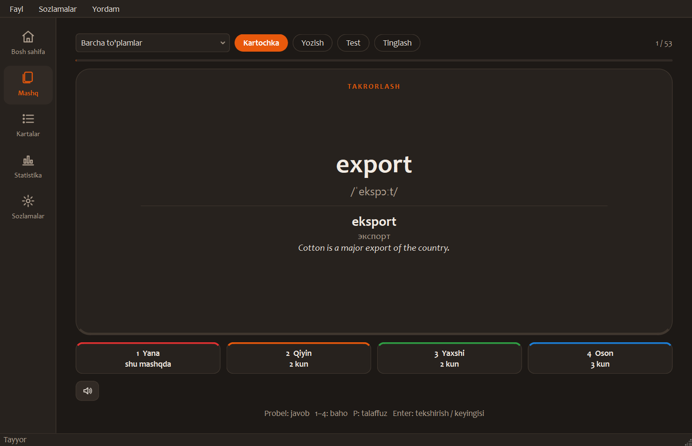

# Inglizcha so‘z kartochkalari: Foydalanish qo‘llanmasi

Muallif: Hakimov Bahtiyorjon. Versiya: 1.0.2.

## 1. Umumiy ma’lumot

“Inglizcha so‘z kartochkalari” – inglizcha so‘zlarni kartochkalar orqali yodlash dasturi. U SM-2 takrorlash algoritmidan foydalanadi: yaxshi eslagan so‘zlaringiz tobora uzoqroq oraliqda qaytadi, unutilganlari esa tez orada yana chiqadi. Shu tariqa har bir so‘z unutilishidan oldin takrorlanadi.

Dasturda to‘rt xil mashq bor: “Kartochka”, “Yozish”, “Test” va “Tinglash”. So‘zlar Windows’ning o‘rnatilgan ovozi bilan internetsiz o‘qib beriladi. Kunlik maqsad, seriya va statistika muntazam shug‘ullanishga yordam beradi.

Dastur bilan uchta tayyor to‘plam keladi: 300 ta eng ko‘p ishlatiladigan so‘z, IELTS Academic uchun boshlang‘ich 150 so‘z va kompyuter grafikasi bo‘yicha 100 termin (jami 550 so‘z). Har bir kartada so‘z, transkripsiya, o‘zbekcha va ruscha tarjima va misol bor. O‘z so‘zlaringizni qo‘shishingiz yoki CSV, Excel va Anki fayllaridan import qilishingiz mumkin.

Dastur talabalar, o‘quvchilar, ingliz tilini mustaqil o‘rganayotganlar va o‘qituvchilar uchun mo‘ljallangan.

Dastur bilan ishlashning tavsiya etiladigan tartibi: har kuni dasturni ochib, “Mashqni boshlash” tugmasi bilan navbatdagi kartalarni takrorlang; yangi so‘zlarni avval “Kartochka” rejimida o‘rganing, so‘ng “Yozish” va “Tinglash” rejimlarida mustahkamlang; haftada bir marta “Statistika” sahifasini ko‘rib chiqing.

## 2. Tizim talablari

- Operatsion tizim: Windows 10 (1809 yoki undan keyingi versiya) yoki Windows 11, 64 bitli (x64).
- Internet aloqasi talab qilinmaydi: dastur, jumladan talaffuz, to‘liq oflayn ishlaydi.
- O‘rnatish shart emas: dastur bitta .exe fayldan iborat.
- Talaffuz uchun Windows’da inglizcha ovoz o‘rnatilgan bo‘lishi kerak. U bo‘lmasa, Windows sozlamalarining “Vaqt va til” – “Nutq” bo‘limidan English (United States) ovozini qo‘shing.
- Ovozni eshitish uchun karnay yoki quloqchin kerak; kompyuter sinfida quloqchin ishlatish tavsiya etiladi.

## 3. O‘rnatish va ishga tushirish

1. Dasturning GitHub sahifasidagi Releases bo‘limidan (https://github.com/eduhakimov/soz-kartochkalari/releases) .exe faylni yuklab oling.
2. Faylni qulay papkaga joylashtiring.
3. Faylni ikki marta bosib ishga tushiring.
4. Birinchi ishga tushirishda Windows SmartScreen ogohlantirishi chiqishi mumkin. Bunday holda “Batafsil”, so‘ng “Baribir ishga tushirish” tugmasini bosing.
Birinchi ishga tushirishda uchta tayyor to‘plam avtomatik qo‘shiladi. “Bosh sahifa” da “Mashqni boshlash” tugmasini bosib, darhol o‘rganishni boshlashingiz mumkin. Yangi versiyaga o‘tish uchun eski .exe faylni almashtiring: kartalar va o‘rganish tarixi profilingizda saqlanadi.

## 4. Dastur oynasi bilan tanishish

Oyna yuqorisida menyu satri (“Fayl”, “Sozlamalar”, “Yordam”), chap tomonda esa beshta sahifa yorlig‘i bor.

**Bosh sahifa** (1-rasm). “Bugungi mashg‘ulot” bloki: bugungi takrorlar va kunlik maqsad halqasi, “Seriya” va “Navbatda” yozuvlari, “Mashqni boshlash” tugmasi. Pastda “To‘plamlar” ro‘yxati, “Yangi to‘plam”, “Import” va “Tayyor to‘plamlar” tugmalari. Har bir to‘plamda “takrorlash”, “yangi”, “jami” sonlari va “O‘rganish” tugmasi.

**Mashq** (2-rasm). To‘plam tanlovi, “Kartochka”, “Yozish”, “Test”, “Tinglash” tugmalari, jarayon raqami (masalan, 1 / 53), karta, baholash tugmalari va talaffuz tugmasi. Pastda tezkor tugmalar eslatmasi: “Probel: javob, 1–4: baho, P: talaffuz, Enter: tekshirish / keyingisi”.

**Kartalar** (3-rasm). To‘plam tanlovi, qidirish maydoni, “Karta qo‘shish” tugmasi, kartalar jadvali va pastda kartalar soni, talaffuz, tahrirlash, o‘chirish, “Eksport” va “Import” tugmalari.

**Statistika** (4-rasm). “Seriya”, “Bugun / maqsad”, “Aniqlik (30 kun)”, “Kartalar” ko‘rsatkichlari va uchta grafik.

**Sozlamalar** (5-rasm). “Kunlik reja”, “Talaffuz” va “Ma’lumotlar” bo‘limlari.

*1-rasm. “Bosh sahifa”: bugungi mashg‘ulot halqasi (13/20), seriya va navbatdagi kartalar soni, uchta tayyor to‘plam takrorlash, yangi va jami kartalar soni bilan*

*2-rasm. “Mashq” sahifasi, “Kartochka” rejimi: “full” so‘zi transkripsiya, o‘zbekcha va ruscha tarjima hamda misol bilan, pastda “Yana”, “Qiyin”, “Yaxshi”, “Oson” baholash tugmalari va keyingi takror oraliqlari*

*3-rasm. “Kartalar” sahifasi: 550 ta karta jadvali (inglizcha so‘z, transkripsiya, o‘zbekcha, ruscha, keyingi takror, to‘plam), qidirish, eksport va import tugmalari*

*4-rasm. “Statistika” sahifasi: seriya, bugungi takrorlar va maqsad, 30 kunlik aniqlik, oxirgi 30 kundagi takrorlar grafigi, kartalar holati va keyingi 7 kun takrorlari*

## 5. Asosiy amallar

**Mashqni boshlash**

1. “Bosh sahifa” da “Mashqni boshlash” tugmasini bosing (barcha to‘plamlar bo‘yicha) yoki kerakli to‘plamdagi “O‘rganish” tugmasini bosing.
2. “Mashq” sahifasida mashq turini tanlang.
3. Navbatdagi kartalar tugaguncha mashq qiling. Oxirida javoblar soni va to‘g‘ri javoblar foizi ko‘rsatiladi.
Navbatda takrorlash vaqti kelgan kartalar va kunlik limit doirasidagi yangi kartalar bo‘ladi. “Hozircha takrorlash yo‘q” yozuvi chiqsa, bugungi ish tugagan: ertaga yana keling.

**Kartochka rejimi**

Kartochka rejimi yangi so‘zlar bilan tanishish uchun eng qulay rejim: unda so‘z, tarjima, misol va talaffuz birga ko‘rsatiladi.

1. So‘zni ko‘ring va ma’nosini eslashga harakat qiling.
2. Probel tugmasi yoki “Javobni ko‘rsatish” bilan javobni oching.
3. O‘zingizni baholang: 1 – “Yana” (eslay olmadim), 2 – “Qiyin”, 3 – “Yaxshi”, 4 – “Oson”. Tugma ostida bu so‘z keyingi safar qachon chiqishi yozilgan.
“Yana” deb baholangan so‘z shu mashq oxirida yana ko‘rsatiladi. Talaffuz tugmasi yoki P tugmasi so‘zni ovoz chiqarib o‘qiydi.

**Yozish rejimi**

1. O‘zbekcha tarjima ko‘rsatiladi.
2. Inglizcha so‘zni klaviaturada yozing va Enter bosing yoki “Tekshirish” tugmasini bosing.
3. Natija “To‘g‘ri”, “Deyarli to‘g‘ri (imlo xatosi)” yoki “Noto‘g‘ri” bo‘ladi. Enter bilan keyingi kartaga o‘ting.
**Test rejimi**

Test rejimi so‘zni tanish darajasini tez tekshirish uchun qulay, ayniqsa yangi o‘rganilgan so‘zlarni birinchi marta mustahkamlashda.

To‘rt variantdan to‘g‘ri tarjimani sichqoncha yoki 1–4 tugmalari bilan tanlang.

**Tinglash rejimi**

So‘z o‘qib beriladi. Eshitganingizni yozing va Enter bosing. Qayta eshitish uchun P tugmasini bosing.

**Karta qo‘shish va tahrirlash**

1. “Kartalar” sahifasida “Karta qo‘shish” tugmasini bosing (Ctrl+N).
2. “To‘plam”, “Inglizcha so‘z”, “Transkripsiya”, “O‘zbekcha”, “Ruscha” va “Misol” maydonlarini to‘ldiring. Inglizcha so‘z va o‘zbekcha tarjima majburiy.
3. Kerak bo‘lsa “Rasm” qatoridagi “Tanlash” tugmasi bilan rasm biriktiring (.png, .jpg, .jpeg, .bmp, .gif, .webp).
4. Saqlang. Holat satrida “Karta qo‘shildi” xabari chiqadi.
Tahrirlash uchun kartani tanlab F2 ni, o‘chirish uchun Del ni bosing. Sichqonchaning o‘ng tugmasi menyusi orqali kartani boshqa to‘plamga o‘tkazish yoki uni o‘rganishni qaytadan boshlash mumkin.

**To‘plam bilan ishlash**

- “Bosh sahifa” dagi “Yangi to‘plam” tugmasi bo‘sh to‘plam yaratadi.
- To‘plam kartochkasidagi amallar belgisi orqali “Kartalarni ko‘rish”, “Nomini o‘zgartirish”, eksport va “To‘plamni o‘chirish” bandlari ochiladi.
- “Tayyor to‘plamlar” menyusidan o‘chirilgan tayyor to‘plamni qayta qo‘shish mumkin; to‘plam bor bo‘lsa, faqat yetishmagan kartalar qo‘shiladi.
**Import qilish**

1. “Import” tugmasini bosing va CSV, Excel (.xlsx) yoki Anki TSV faylni tanlang.
2. “Kartalarni import qilish” oynasida “Qaysi to‘plamga” ni tanlang.
3. “Birinchi qator sarlavha” bayrog‘ini kerak bo‘lsa belgilang.
4. Har bir ustun nimani bildirishini tanlang; keraksiz ustun uchun “(o‘tkazib yuborish)” ni tanlang. “Inglizcha so‘z” ustuni majburiy.
5. Tasdiqlang. Natijada nechta karta qo‘shilgani va nechta takroriy karta o‘tkazib yuborilgani ko‘rsatiladi.
**Eksport qilish**

Import fayli namunasi: birinchi qatorda “word”, “ipa”, “uz”, “ru”, “example” kabi sarlavhalar, keyingi qatorlarda har bir so‘z alohida qatorda. CSV faylda ajratgich vergul, nuqtali vergul yoki tabulyatsiya bo‘lishi mumkin – dastur uni o‘zi aniqlaydi. Anki’dan eksport qilingan matnli fayllar ham qabul qilinadi.

“Kartalar” sahifasidagi “Eksport” menyusidan CSV, Excel yoki “TSV (Anki uchun)” formatini tanlang va fayl nomini kiriting.

**Kartalarni qidirish**

1. “Kartalar” sahifasida yuqoridagi ro‘yxatdan to‘plamni yoki “Barcha to‘plamlar” ni tanlang.
2. “So‘z yoki tarjima bo‘yicha qidirish” maydoniga so‘zning bir qismini yozing. Jadval darhol saralanadi.
3. “Keyingi takror” ustunida “yangi” yozuvi karta hali o‘rganilmaganini, sana esa keyingi takror kunini bildiradi.
**Statistikani ko‘rish**

- “Seriya” – kunlik maqsad bajarilgan ketma-ket kunlar soni.
- “Bugun / maqsad” – bugungi takrorlar soni va kunlik maqsad.
- “Aniqlik (30 kun)” – oxirgi 30 kundagi to‘g‘ri javoblar ulushi.
- Grafiklar: oxirgi 30 kundagi takrorlar, kartalar holati (yangi, o‘rganilmoqda, o‘zlashtirilgan) va keyingi 7 kun takrorlari prognozi.

## 6. Sozlamalar

- **Kunlik maqsad (takrorlar).** Kuniga nechta takror qilishni maqsad qilasiz (standart 20, 5 dan 500 gacha). Maqsad bajarilgan kunlar seriyani tashkil qiladi.
- **Kuniga yangi kartalar.** Har kuni nechta yangi so‘z qo‘shilishi (standart 10, 0 dan 200 gacha). Yangi so‘zlarni vaqtincha to‘xtatish uchun 0 ni qo‘ying: bu holda faqat avval o‘rganilgan so‘zlar takrorlanadi.
- **Ovoz.** Tizimdagi ovozlardan birini tanlang (masalan, inglizcha ovoz).
- **Tezlik.** Talaffuz tezligini surgich bilan sozlang; “Tinglab ko‘rish” tugmasi bilan tekshiring.
- **Kartochka ochilganda so‘zni avtomatik o‘qish.** Yoqilgan bo‘lsa, har bir karta ochilganda so‘z o‘qib beriladi.
- **Papkani ochish.** Ma’lumotlar bazasi turgan papkani ochadi.
- **Tavsiya.** Boshlovchilar uchun kunlik maqsadni 20 ta takror va kuniga 10 ta yangi karta atrofida qoldirish ma’qul: bu dasturning standart qiymatlari. Takrorlar ko‘payib ketsa, avval yangi kartalar sonini kamaytiring.
- **Til va mavzu.** “Sozlamalar” menyusidagi “Til” (o‘zbek, rus, ingliz) va “Mavzu” (“Yorug‘”, “Qorong‘i”, “Tizim bo‘yicha”) bandlari. Qorong‘i mavzu 6-rasmda ko‘rsatilgan.

*5-rasm. “Sozlamalar” sahifasi: kunlik maqsad, kuniga yangi kartalar soni, talaffuz ovozi va tezligi, ma’lumotlar papkasi*

*6-rasm. “Mashq” sahifasi qorong‘i mavzuda: “export” so‘zi kartochkasi*

## 7. Ma’lumotlarni saqlash va xavfsizlik

- Kartalar, to‘plamlar va o‘rganish tarixi %APPDATA%\BahtiyorSoft\soz-kartochkalari papkasidagi SQLite baza faylida, kartalarga biriktirilgan rasmlar esa shu papkadagi alohida papkada saqlanadi. Bazaning to‘liq yo‘li “Sozlamalar” sahifasida ko‘rsatiladi.
- Dastur internetga ulanmaydi va ma’lumotlarni hech qayerga yubormaydi.
- Import qilinayotgan fayllar faqat o‘qiladi va o‘zgartirilmaydi.
- Baza fayli buzilgan bo‘lsa, dastur uni zaxiraga ko‘chirib, yangi baza bilan ishga tushadi.
- To‘plamni o‘chirish undagi barcha kartalarni va ularning o‘rganish holatini o‘chiradi; bu amaldan oldin tasdiq so‘raladi. Muhim to‘plamlarni oldindan eksport qilib qo‘ying.
- Zaxira nusxa olish uchun dasturni yopib, ma’lumotlar papkasini nusxalang yoki to‘plamlarni Excel’ga eksport qiling. Eksport faylida o‘rganish holati saqlanmasligini hisobga oling.

## 8. Ko‘p uchraydigan savollar va muammolar

**So‘z o‘qilmayapti.** “Sozlamalar” – “Talaffuz” bo‘limida inglizcha ovoz tanlanganini tekshiring. “Inglizcha ovoz o‘rnatilmagan” xabari chiqsa, Windows sozlamalarining “Vaqt va til” – “Nutq” bo‘limidan English (United States) ovozini qo‘shing. “Windows nutq sintezi (SAPI) topilmadi” xabari chiqsa, talaffuz o‘chiriladi, qolgan imkoniyatlar ishlaydi.

**“Hozircha takrorlash yo‘q” chiqmoqda.** Bugungi takrorlar tugagan va yangi kartalar limiti tugagan. Ertaga davom eting yoki “Sozlamalar” da “Kuniga yangi kartalar” sonini oshiring.

**Javobim to‘g‘ri edi, lekin “Deyarli to‘g‘ri” deb baholandi.** Bu kichik imlo xatosi borligini bildiradi. So‘zning to‘g‘ri yozilishini qarab chiqing.

**Yozish rejimida katta harf yoki apostrof sababli javob xato hisoblanadimi?** Yo‘q. Javob tekshirilganda katta-kichik harf, apostrof turi va qavs ichidagi izohlar hisobga olinmaydi.

**Tarjimada bir nechta variant bor, qaysi birini yozish kerak?** Vergul, nuqtali vergul yoki qiya chiziq bilan ajratilgan variantlarning istalgani qabul qilinadi.

**Import qilishda “Inglizcha so‘z” ustunini tanlang degan xabar chiqdi.** Ustunlar mosligini tanlashda inglizcha so‘zlar joylashgan ustunni “Inglizcha so‘z” deb belgilang.

**Import qilingan faylda harflar buzildi.** Faylni UTF-8 kodlashida saqlab, qayta import qiling.

**Seriya nolga tushdi.** Seriya kunlik maqsad bajarilgan ketma-ket kunlarni sanaydi. Bir kun maqsad bajarilmasa, seriya qaytadan boshlanadi.

**Bir so‘zni ikkinchi marta qo‘shib qo‘ydim.** Import paytida takroriy kartalar avtomatik o‘tkazib yuboriladi. Qo‘lda qo‘shilgan takrorni “Kartalar” sahifasida topib, Del bilan o‘chiring.

**So‘zni o‘rganishni boshidan boshlamoqchiman.** Kartani tanlab, sichqonchaning o‘ng tugmasi menyusidan “O‘rganishni qaytadan boshlash” ni tanlang.

**SmartScreen dasturni ochishga ruxsat bermayapti.** “Batafsil”, so‘ng “Baribir ishga tushirish” ni bosing. Faylni faqat rasmiy GitHub sahifasidan yuklab oling.

