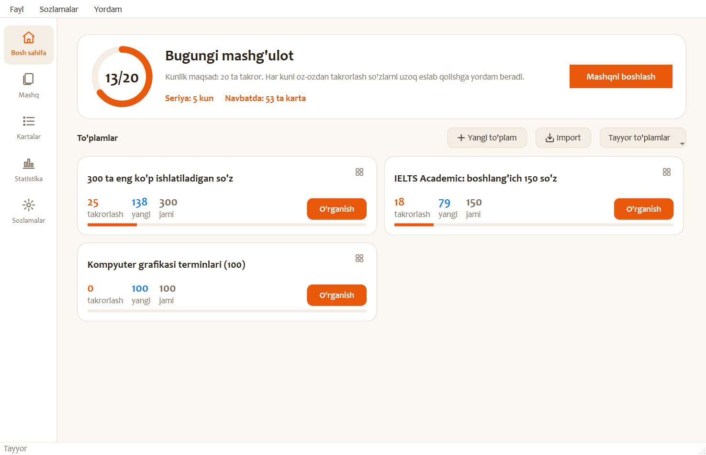
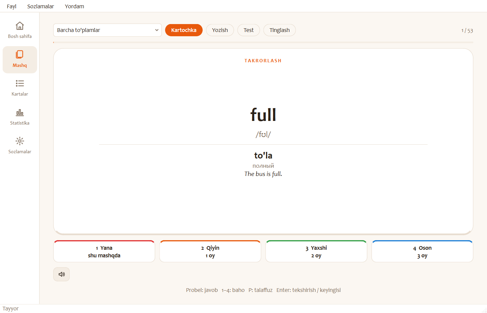
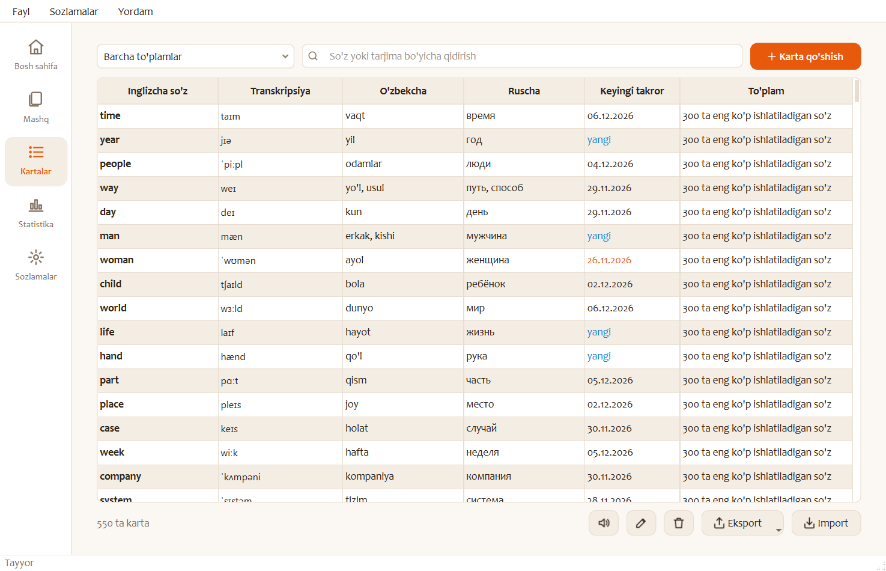
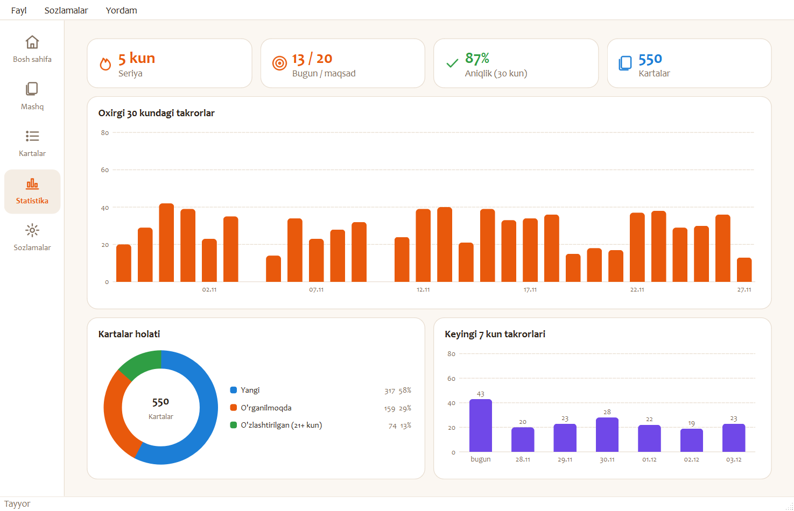

UDK: 004.42:37.016:811.111

# SM-2 oraliqli takrorlash algoritmiga asoslangan inglizcha so‘zlarni yodlash uchun oflayn dasturiy vosita: arxitektura va amalga oshirish

**Hakimov Bahtiyorjon**  
*[ish joyi, lavozimi, elektron pochta]*

**Annotatsiya.** Maqolada inglizcha so‘zlarni kartochkalar orqali yodlash uchun mo‘ljallangan “Inglizcha so‘z kartochkalari” dasturiy vositasi tavsiflanadi. Dastur Python 3.12, PySide6 va SQLite asosida yaratilgan va internetsiz ishlaydi. Unda SM-2 oraliqli takrorlash algoritmi to‘rt tugmali baholash bilan, to‘rt xil mashq turi (kartochka, yozib javob berish, to‘rt variantli test, tinglab yozish), javobni imlo xatolariga bardoshli tekshirish, Windows nutq sintezi (SAPI) orqali oflayn talaffuz, kunlik maqsad, seriya va statistik grafiklar, CSV, Excel va Anki TSV formatlarida import va eksport amalga oshirilgan. Dastur jami 550 so‘zdan iborat uchta tayyor to‘plam bilan tarqatiladi, kartada o‘zbekcha va ruscha tarjima beriladi. Ishonchlilik 27 ta avtomatik test bilan tekshirilgan.

*Kalit so‘zlar:* oraliqli takrorlash, SM-2 algoritmi, so‘z boyligi, ingliz tili, kartochka, nutq sintezi, oflayn dastur.

**Офлайн-программное средство для запоминания английских слов на основе алгоритма интервальных повторений SM-2: архитектура и реализация**

**Аннотация.** В статье описывается программное средство «Карточки английских слов», предназначенное для запоминания английской лексики с помощью карточек. Программа разработана на Python 3.12, PySide6 и SQLite и работает без интернета. Реализованы алгоритм интервальных повторений SM-2 с оценкой по четырём кнопкам, четыре вида упражнений (карточка, ввод ответа, тест с четырьмя вариантами, аудирование), проверка ответа с допуском опечаток, офлайн-произношение через синтез речи Windows (SAPI), дневная цель, серия и статистические графики, импорт и экспорт в форматах CSV, Excel и Anki TSV. Программа поставляется с тремя готовыми наборами общим объёмом 550 слов, на карточке даются узбекский и русский переводы. Надёжность проверена 27 автоматическими тестами.

*Ключевые слова:* интервальное повторение, алгоритм SM-2, словарный запас, английский язык, карточки, синтез речи, офлайн-приложение.

**An offline software tool for memorising English vocabulary based on the SM-2 spaced repetition algorithm: architecture and implementation**

**Abstract.** The paper describes English Word Cards, a software tool for memorising English vocabulary with flashcards. The program is built with Python 3.12, PySide6 and SQLite and works offline. It implements the SM-2 spaced repetition algorithm with four-button grading, four exercise types (flashcard, typed answer, four-option quiz, listening), typo-tolerant answer checking, offline pronunciation through Windows speech synthesis (SAPI), a daily goal, streaks and statistical charts, and import and export in CSV, Excel and Anki TSV formats. The program ships with three ready-made decks totalling 550 words, with Uzbek and Russian translations on each card. Reliability is verified by 27 automated tests.

*Keywords:* spaced repetition, SM-2 algorithm, vocabulary, English language, flashcards, speech synthesis, offline application.

## Kirish

Chet tilini o‘rganishda so‘z boyligi asosiy tarkibiy qismlardan biridir: o‘qish, tinglash, yozish va gapirish ko‘nikmalari ma’lum hajmdagi faol va passiv lug‘atga tayanadi. O‘zbekiston ta’lim tizimida ingliz tilini o‘qitishga katta e’tibor qaratilmoqda, talabalar xalqaro til sertifikatlariga tayyorlanmoqda, mutaxassislik fanlari esa tobora ko‘proq inglizcha atamalar bilan bog‘liq bo‘lmoqda. Shu sababli so‘zlarni samarali yodlash va uzoq muddat esda saqlash usullariga ehtiyoj yuqori.

So‘zlarni yodlashda an’anaviy usullar – lug‘at daftari, qog‘oz kartochkalar, so‘zlar ro‘yxatini qayta-qayta o‘qish – ko‘pincha bir xil oraliqda takrorlashga asoslanadi. Bunda yaxshi eslab qolingan so‘zlarga ortiqcha vaqt sarflanadi, qiyin so‘zlar esa yetarlicha takrorlanmaydi. Oraliqli takrorlash g‘oyasi shundan iboratki, har bir so‘z o‘quvchi uni unutishga yaqin bo‘lgan paytda qaytariladi, oraliq esa har bir muvaffaqiyatli eslashdan so‘ng uzayib boradi. Bu yondashuvning eng mashhur algoritmlaridan biri P. Vozniak tomonidan taklif qilingan SM-2 algoritmidir.

Mavjud oraliqli takrorlash dasturlarining ko‘pchiligi interfeysi va tayyor to‘plamlari bo‘yicha o‘zbek tilida so‘zlashuvchi foydalanuvchiga moslashtirilmagan, ayrimlari esa doimiy internet aloqasini yoki hisob yaratishni talab qiladi. Ta’lim muassasalarining kompyuter sinflarida internet har doim ham mavjud bo‘lmasligi, shuningdek talabalar ma’lumotlarining maxfiyligi ham hisobga olinishi kerak.

Ta’limni raqamlashtirish, jumladan “Raqamli O‘zbekiston – 2030” strategiyasida belgilangan vazifalar, mahalliy sharoitga moslashtirilgan o‘quv dasturiy vositalarini yaratishni dolzarb qiladi. Ushbu maqolada shunday vositalardan biri – “Inglizcha so‘z kartochkalari” dasturining vazifasi, arxitekturasi, takrorlash algoritmi, mashq turlari va sinov natijalari bayon etiladi.

Dastur nomida ingliz tili ko‘rsatilgan bo‘lsa-da, uning ma’lumot modeli istalgan atamalar lug‘atiga mos keladi: o‘qituvchi o‘z fanining inglizcha atamalarini o‘zbekcha va ruscha izohlari bilan kiritib, mutaxassislik bo‘yicha to‘plam yaratishi mumkin. Tayyor to‘plamlar orasidagi kompyuter grafikasi terminlari to‘plami aynan shunday foydalanishga misol bo‘lib xizmat qiladi.

## Muammoning qo‘yilishi va mavjud yechimlar tahlili

Tadqiqot maqsadi – inglizcha so‘zlarni oraliqli takrorlash usulida o‘rganish uchun o‘zbekcha interfeysli, o‘zbekcha va ruscha tarjimali, internetsiz ishlovchi, bir nechta mashq turini va talaffuzni qo‘llab-quvvatlovchi ish stoli ilovasini ishlab chiqish. Maqsadga erishish uchun quyidagi vazifalar qo‘yildi:

- SM-2 algoritmini foydalanuvchi uchun tushunarli to‘rt tugmali baholashga moslab amalga oshirish;
- kartochka, yozish, test va tinglash mashqlarini bitta takrorlash navbati bilan bog‘lash;
- yozma javobni registr, apostrof turi, qavs ichidagi izohlar va kichik imlo xatolariga bardoshli tekshirish;
- internetsiz ishlovchi talaffuz manbasidan foydalanish;
- kunlik yangi so‘zlar limiti, kunlik maqsad va seriya orqali muntazam mashg‘ulotni rag‘batlantirish;
- o‘rganish jarayonini grafiklar orqali ko‘rsatish;
- tashqi manbalardan (jadval fayllari, Anki eksporti) kartalar import qilish va ularni eksport qilish;
- tayyor o‘zbekcha to‘plamlar bilan ta’minlash.
Mavjud yechimlarni ular foydalanadigan texnologiya va tarqatish usuli bo‘yicha umumiy turlarga ajratish mumkin. Birinchi tur – oraliqli takrorlashning universal ochiq dasturlari: ular kuchli va moslashuvchan, biroq sozlash murakkab, tayyor to‘plamlar asosan boshqa tillarda va interfeysni o‘zbek tilida to‘liq ko‘rish har doim ham mumkin emas. Ikkinchi tur – til o‘rganish uchun mobil va onlayn platformalar: ular o‘yin elementlariga boy, ammo internet va hisob yaratishni talab qiladi, o‘qituvchining o‘z so‘zlar ro‘yxatini qo‘shish imkoniyati cheklangan bo‘lishi mumkin. Uchinchi tur – an’anaviy qog‘oz kartochkalar va lug‘at daftarlari, ya’ni ko‘plab o‘quvchilar hali ham foydalanadigan usul: ular oddiy va ishonchli, lekin takrorlash vaqtini avtomatik rejalashtirmaydi va talaffuzni bermaydi.

Shu asosda vosita uchun quyidagi talablar shakllantirildi: o‘rnatishsiz bitta fayl; internetsiz ishlash; o‘zbek, rus va ingliz tilidagi interfeys; o‘qituvchi o‘z to‘plamini jadval fayli orqali tez tayyorlay olishi; foydalanuvchi ma’lumotlarining faqat kompyuterda saqlanishi. Sifat mezonlari sifatida takrorlash jadvalining bir necha oy davomida to‘g‘ri hisoblanishi, kunlik yangi kartalar limitiga rioya qilinishi, turli kodlashdagi fayllarning to‘g‘ri import qilinishi va buzilgan ma’lumotlar bazasining dasturni ishdan chiqarmasligi belgilandi.

## Tadqiqot metodologiyasi va dasturiy arxitektura

Dastur Python 3.12 tilida yozilgan, grafik interfeys Qt 6 asosidagi PySide6 kutubxonasida yaratilgan. Ma’lumotlar Python standart kutubxonasidagi sqlite3 moduli orqali SQLite bazasida saqlanadi, Excel fayllari openpyxl kutubxonasi yordamida o‘qiladi va yoziladi, talaffuz uchun pywin32 orqali Windows’ning Microsoft Speech API (SAPI) nutq sintezi komponentiga murojaat qilinadi. Dastur PyInstaller yordamida bitta .exe faylga yig‘iladi. Uchinchi tomon komponentlari va litsenziyalari THIRD PARTY NOTICES hujjatida keltirilgan.

Kod quyidagi modullarga ajratilgan:

- **srs** – interfeysdan mustaqil mantiq: SM-2 algoritmi, keyingi takror sanasini hisoblash, tugmalar ostidagi oraliqlarni oldindan ko‘rsatish, karta toifasi, javobni normallashtirish va solishtirish, seriya hisoblash;
- **db** – SQLite bazasi: to‘plamlar, kartalar, takrorlar jurnali, takrorlash navbati, tayyor to‘plamlarni yuklash, buzilgan bazani zaxiralash;
- **cardio** – CSV, Excel va TSV fayllarni o‘qish va yozish, ustunlarni moslashtirish;
- **tts** – Windows nutq sintezi bilan ishlash: ovozlar ro‘yxati, ovoz tanlash, tezlik va matn tilini aniqlash;
- **window**, **ui extra** va **strings** – beshta sahifali interfeys, grafiklar va uch tildagi matnlar;
- **uzkit** – menyu, til, mavzu, sozlamalar va fayl yo‘llari uchun umumiy karkas.
Ma’lumot modeli. Bazada to‘rt jadval bor: to‘plamlar, kartalar, takrorlar va xizmat ma’lumotlari. Karta inglizcha so‘z, transkripsiya, o‘zbekcha va ruscha tarjima, misol, rasm va takrorlash holatidan (takrorlar soni, oraliq, osonlik koeffitsiyenti, unutishlar soni, keyingi takror sanasi, ko‘rilganlik belgisi) iborat. Har bir javob takrorlar jadvaliga vaqt, kun, baho, mashq turi va karta yangi bo‘lgan-bo‘lmaganligi bilan yoziladi; statistika aynan shu jurnal asosida hisoblanadi.

Takrorlash algoritmi. SM-2 algoritmida javob sifati q 0 dan 5 gacha baholanadi, har bir karta uchun osonlik koeffitsiyenti EF (boshlang‘ich qiymati 2,5) yuritiladi va har javobdan keyin yangi qiymat EF + (0,1 – (5 – q)(0,08 + (5 – q)·0,02)) formulasi bo‘yicha hisoblanadi, bunda EF 1,3 dan kichik bo‘lmaydi. Interfeysdagi to‘rt tugma q qiymatlariga quyidagicha moslangan: “Yana” – 1, “Qiyin” – 3, “Yaxshi” – 4, “Oson” – 5. q 3 dan kichik bo‘lsa, karta qayta o‘rganishga qaytadi: takrorlar soni nolga tushadi, oraliq 1 kun bo‘ladi va unutishlar soni oshadi. Aks holda birinchi muvaffaqiyatli takrordan keyin oraliq 1 kun (“Oson” bahosida 4 kun), ikkinchisidan keyin “Qiyin” uchun 4, “Yaxshi” uchun 6, “Oson” uchun 8 kun bo‘ladi. Keyingi takrorlarda “Yaxshi” bahosida oraliq oldingi oraliqning EF ga ko‘paytmasiga teng, “Qiyin” bahosida oldingi oraliqning 1,2 ga ko‘paytmasi (kamida bir kunga uzaytirilgan holda), “Oson” bahosida esa “Yaxshi” oralig‘idan 1,3 marta uzunroq olinadi. Bu kengaytma to‘rt tugmaning har biri turli natija berishini ta’minlaydi. Har bir tugma ostida shu baho tanlansa karta qachon qaytishi oldindan ko‘rsatiladi. Oraliq 21 kun va undan ko‘p bo‘lgan karta “o‘zlashtirilgan”, hali ko‘rilmagan karta “yangi”, qolganlari esa “o‘rganilmoqda” toifasiga kiradi; statistika sahifasidagi halqasimon diagramma aynan shu toifalar bo‘yicha tuziladi.

Javobni tekshirish. Yozish va tinglash mashqlarida foydalanuvchi javobi va to‘g‘ri javob normallashtiriladi: Unicode NFKC shakliga keltiriladi, kichik harfga o‘tkaziladi, barcha apostrof turlari bir xil belgiga almashtiriladi, qavs ichidagi izohlar va tinish belgilari olib tashlanadi. To‘g‘ri javobda vergul, nuqtali vergul yoki qiya chiziq bilan ajratilgan bir nechta variant bo‘lsa, ularning har biri alohida qabul qilinadi. Javob variantlardan biriga aynan mos kelsa “to‘g‘ri”, Levenshtein masofasi qisqa so‘zlar (7 belgigacha) uchun 1 dan, uzunroq so‘zlar uchun 2 dan oshmasa “deyarli to‘g‘ri (imlo xatosi)”, aks holda “noto‘g‘ri” deb baholanadi. Bu natijalar mos ravishda “Yaxshi”, “Qiyin” va “Yana” baholariga aylantiriladi.

Test rejimida noto‘g‘ri variantlar avvalo shu to‘plamdagi boshqa kartalar tarjimalaridan, ular yetmasa boshqa to‘plamlardan tasodifiy tanlanadi; to‘g‘ri javob ular orasiga aralashtiriladi. Tinglash rejimida so‘z nutq sintezi orqali o‘qiladi va javob yozish rejimidagi kabi tekshiriladi. Shu tariqa to‘rt mashq turi bitta takrorlash navbati va bitta baholash tizimiga bog‘langan: qaysi rejimda mashq qilinmasin, natija kartaning takrorlash jadvaliga ta’sir qiladi.

Takrorlash navbati va kunlik limit. Navbat muddati yetgan kartalar va kunlik limit doirasidagi yangi kartalardan tuziladi. Kuniga yangi kartalar soni (standart holatda 10, 0 dan 200 gacha) va kunlik maqsad (standart holatda 20 ta takror, 5 dan 500 gacha) sozlamalarda belgilanadi. “Yana” bahosini olgan karta shu mashq oxirida qayta ko‘rsatiladi. Seriya kunlik maqsad bajarilgan ketma-ket kunlar soni sifatida hisoblanadi; bugun maqsad hali bajarilmagan bo‘lsa, seriya kechagi kundan sanaladi, shuning uchun kun davomida u nolga tushib qolmaydi.

Talaffuz. So‘z Windows’ning o‘rnatilgan nutq sintezi orqali o‘qiladi, internet talab qilinmaydi. Foydalanuvchi tizimdagi ovozlardan birini tanlaydi va tezlikni sozlaydi. Inglizcha ovoz o‘rnatilmagan bo‘lsa, dastur Windows sozlamalaridan uni qo‘shish yo‘lini ko‘rsatadi; SAPI topilmasa, talaffuz o‘chiriladi va dastur ishini davom ettiradi.

Saqlash va xavfsizlik. Baza va kartalarga biriktirilgan rasmlar foydalanuvchi profilidagi %APPDATA%\BahtiyorSoft\soz-kartochkalari papkasida saqlanadi. Baza fayli buzilgan bo‘lsa, u zaxiraga ko‘chiriladi va yangi baza yaratiladi. Import qilingan fayllar faqat o‘qiladi, takroriy kartalar o‘tkazib yuboriladi. Dastur internetga murojaat qilmaydi.

Import va eksport. CSV va TSV fayllar turli kodlashlarda o‘qiladi, ajratgich avtomatik aniqlanadi, Excel fayllar openpyxl orqali o‘qiladi. Foydalanuvchi har bir ustunning vazifasini tanlaydi, shu sababli tayyor jadvallarni oldindan qayta tartiblash shart emas. Eksport CSV, Excel va Anki dasturi qabul qiladigan TSV formatida bajariladi; Excel eksportida to‘plam nomidagi fayl nomlari uchun taqiqlangan belgilar hisobga olinadi.

Ma’lumot oqimi quyidagicha. Mashq boshlanganda bazadan muddati yetgan va kunlik limit doirasidagi yangi kartalar olinib, navbat tuziladi. Har bir javobdan keyin karta holati SM-2 bo‘yicha yangilanadi, keyingi takror sanasi hisoblanadi va javob takrorlar jurnaliga yoziladi. “Bosh sahifa” va “Statistika” sahifalaridagi ko‘rsatkichlar jurnal va kartalar holatidan qayta hisoblanadi.

## Amalga oshirish va asosiy funksiyalar

Dastur oynasining chap tomonida beshta sahifa yorlig‘i joylashgan: “Bosh sahifa”, “Mashq”, “Kartalar”, “Statistika” va “Sozlamalar”.

“Bosh sahifa” (1-rasm) “Bugungi mashg‘ulot” blokidan boshlanadi: unda bugungi takrorlar soni kunlik maqsadga nisbatan halqa ko‘rinishida, seriya va navbatdagi kartalar soni ko‘rsatiladi, “Mashqni boshlash” tugmasi esa barcha to‘plamlar bo‘yicha mashqni boshlaydi. Pastda “To‘plamlar” ro‘yxati joylashgan: har bir to‘plam kartochkasida takrorlanadigan, yangi va jami kartalar soni, o‘zlashtirish chizig‘i va “O‘rganish” tugmasi bor. “Yangi to‘plam”, “Import” va “Tayyor to‘plamlar” tugmalari to‘plam yaratish, fayldan kartalar qo‘shish va tayyor to‘plamlarni qayta qo‘shish uchun xizmat qiladi. Dastur bilan uchta tayyor to‘plam keladi: 300 ta eng ko‘p ishlatiladigan so‘z, IELTS Academic uchun boshlang‘ich 150 so‘z va kompyuter grafikasi bo‘yicha 100 termin.

“Mashq” sahifasi (2-rasm) yuqorisida to‘plam tanlovi, to‘rt mashq turi tugmalari va jarayon ko‘rsatkichi joylashgan. “Kartochka” rejimida so‘z ko‘rsatiladi, foydalanuvchi uni eslashga harakat qiladi va probel bilan javobni ochadi: transkripsiya, o‘zbekcha va ruscha tarjima va misol chiqadi. So‘ng u o‘zini 1–4 tugmalari bilan baholaydi; har bir tugma ostida keyingi takrorgacha qolgan vaqt (“shu mashqda”, “2 kun”, “1 oy” va hokazo) yozilgan. “Yozish” rejimida o‘zbekcha tarjima ko‘rsatiladi va inglizcha so‘zni yozish kerak, “Test” rejimida to‘rt variantdan to‘g‘ri tarjima tanlanadi, “Tinglash” rejimida so‘z o‘qib beriladi va eshitilganini yozish kerak (P tugmasi qayta eshittiradi). Javobdan so‘ng natija “To‘g‘ri”, “Deyarli to‘g‘ri (imlo xatosi)” yoki “Noto‘g‘ri” ko‘rinishida rangli belgi bilan chiqadi. Mashq oxirida javoblar soni va to‘g‘ri javoblar foizi ko‘rsatiladi. Qorong‘i mavzudagi ko‘rinish 6-rasmda berilgan.

“Kartalar” sahifasi (3-rasm) barcha kartalarni jadvalda ko‘rsatadi: inglizcha so‘z, transkripsiya, o‘zbekcha, ruscha, keyingi takror sanasi va to‘plam. To‘plam bo‘yicha filtr va so‘z yoki tarjima bo‘yicha qidirish mavjud. “Karta qo‘shish” (Ctrl+N), tahrirlash (F2), o‘chirish (Del), talaffuz, eksport va import tugmalari bor; kontekst menyusi orqali kartani boshqa to‘plamga o‘tkazish yoki o‘rganishni qaytadan boshlash mumkin. Kartaga rasm biriktirish ham ko‘zda tutilgan.

“Statistika” sahifasi (4-rasm) to‘rtta ko‘rsatkich (seriya, bugungi takrorlar va maqsad, oxirgi 30 kundagi aniqlik, kartalar soni), oxirgi 30 kundagi takrorlar ustunli grafigi, kartalar holati (yangi, o‘rganilmoqda, o‘zlashtirilgan) halqasimon diagrammasi va keyingi 7 kun takrorlari prognozini o‘z ichiga oladi. Eng uzun seriya ham ko‘rsatiladi.

“Sozlamalar” sahifasi (5-rasm) “Kunlik reja” (kunlik maqsad, kuniga yangi kartalar), “Talaffuz” (ovoz, tezlik, “Tinglab ko‘rish” tugmasi, “Kartochka ochilganda so‘zni avtomatik o‘qish” bayrog‘i) va “Ma’lumotlar” (baza fayli yo‘li va “Papkani ochish” tugmasi) bo‘limlaridan iborat.

Import oynasida fayldagi qatorlar soni ko‘rsatiladi, foydalanuvchi har bir ustun nimani bildirishini (inglizcha so‘z, transkripsiya, o‘zbekcha, ruscha, misol yoki o‘tkazib yuborish) tanlaydi, birinchi qator sarlavha ekanini belgilaydi va kartalar qaysi to‘plamga qo‘shilishini ko‘rsatadi. Natijada qo‘shilgan va takror bo‘lgani uchun o‘tkazib yuborilgan kartalar soni chiqadi. Eksport CSV, Excel va Anki uchun TSV formatlarida bajariladi.

Odatiy ish ssenariysi quyidagicha. O‘qituvchi mutaxassislik fani bo‘yicha 50 ta atamani o‘zbekcha va ruscha tarjimasi bilan Excel jadvalida tayyorlaydi va talabalarga tarqatadi. Talaba faylni import qilib, yangi to‘plam yaratadi. Har kuni dasturni ochib, “Mashqni boshlash” tugmasi bilan navbatdagi kartalarni takrorlaydi: avval “Kartochka” rejimida, so‘ng mustahkamlash uchun “Yozish” va “Tinglash” rejimlarida. Bir necha haftadan so‘ng “Statistika” sahifasida o‘zlashtirilgan kartalar ulushining o‘sishini va keyingi kunlardagi takrorlar prognozini kuzatadi, kerak bo‘lsa kuniga yangi kartalar sonini moslaydi.

*1-rasm. “Bosh sahifa”: bugungi mashg‘ulot halqasi (13/20), seriya va navbatdagi kartalar soni, uchta tayyor to‘plam takrorlash, yangi va jami kartalar soni bilan*

*2-rasm. “Mashq” sahifasi, “Kartochka” rejimi: “full” so‘zi transkripsiya, o‘zbekcha va ruscha tarjima hamda misol bilan, pastda “Yana”, “Qiyin”, “Yaxshi”, “Oson” baholash tugmalari va keyingi takror oraliqlari*

*3-rasm. “Kartalar” sahifasi: 550 ta karta jadvali (inglizcha so‘z, transkripsiya, o‘zbekcha, ruscha, keyingi takror, to‘plam), qidirish, eksport va import tugmalari*

*4-rasm. “Statistika” sahifasi: seriya, bugungi takrorlar va maqsad, 30 kunlik aniqlik, oxirgi 30 kundagi takrorlar grafigi, kartalar holati va keyingi 7 kun takrorlari*

## Sinov va natijalar

Dasturning to‘g‘riligi pytest asosidagi 27 ta avtomatik test funksiyasi bilan tekshiriladi; ularning ayrimlari parametrlangan.

- **Mantiq testlari (14 ta).** “Yaxshi” baholari ketma-ketligida SM-2 oraliqlari; EF ning o‘zgarishi va 1,3 chegarasi; unutishda holatning tiklanishi; takror sanalari va tugmalar ostidagi oraliqlar; javobni tekshirish; seriyani hisoblash; uchta tayyor to‘plamning kartalar soni; navbat va javobni qayd etish; test uchun noto‘g‘ri variantlar tanlash va qidirish; sarlavhali, nuqtali vergul bilan ajratilgan CSV importi; Anki TSV importi; Excel va TSV aylanma eksport va import; talaffuz uchun matn tilini aniqlash; interfeysdagi mashq rejimlari.
- **Ssenariy testlari (11 ta).** Bir necha oylik simulyatsiyada SM-2 jadvali; kunlik yangi kartalar limiti; turli kodlashdagi fayllarni import qilish; Anki va Excel aylanma o‘tkazish; o‘zbekcha apostroflar bilan javobni tekshirish; buzilgan bazani zaxiralash; noto‘g‘ri turdagi sozlamalar; kartochka mashqi va baholash tugmalarini ketma-ket ko‘p bosish; yozish va test rejimlari; nomida ikki nuqta bo‘lgan to‘plamni Excel’ga eksport qilish; buzilgan sozlamalar faylini tiklash.
- **Tutun testlari (2 ta).** Asosiy oynaning yaratilishi va uch tildagi tarjimalarning to‘liqligi.
Funksional ko‘rsatkichlar: 3 ta tayyor to‘plam (300, 150 va 100 karta, jami 550 ta); 4 ta mashq turi; 4 ta baholash tugmasi; karta maydonlari – inglizcha so‘z, transkripsiya, o‘zbekcha va ruscha tarjima, misol, rasm; import va eksport formatlari – CSV, Excel (.xlsx) va Anki TSV; statistikada 3 ta grafik. Interfeys tillari – o‘zbek, rus va ingliz. Dastur Windows 10 (1809 va undan keyingi) va Windows 11 x64 tizimlarida o‘rnatishsiz ishlaydi.

Takrorlash algoritmi soxta sana yordamida bir necha oylik davr bo‘yicha modellashtirilgani uni real vaqt kutmasdan tekshirish imkonini berdi. Interfeys testlari Qt oynasini ekranga chiqarmasdan yaratadi. Dasturning o‘quv samaradorligi (masalan, so‘zlarni eslab qolish darajasi) bo‘yicha pedagogik tajriba, ish tezligi yoki foydalanuvchilar soni bo‘yicha o‘lchovlar o‘tkazilmagan, shuning uchun bunday ko‘rsatkichlar keltirilmaydi.

## Muhokama

Dasturning asosiy afzalliklari quyidagilardan iborat. Birinchidan, SM-2 algoritmi to‘rt tugmali, har bir tugma ostida natijasi ko‘rsatilgan baholash bilan birlashtirilgan, bu esa foydalanuvchiga algoritm mantiqini tushunish va o‘zini ongli baholash imkonini beradi. Ikkinchidan, to‘rt mashq turi so‘zni turli kanallar orqali – tanish, yozish, tanlash va eshitish – mustahkamlaydi. Uchinchidan, javobni tekshirishda apostroflar, qavsdagi izohlar va kichik imlo xatolari hisobga olinadi, bu o‘zbek foydalanuvchisi uchun muhim. To‘rtinchidan, tayyor to‘plamlar o‘zbekcha va ruscha tarjima bilan berilgan, o‘qituvchi esa o‘z to‘plamini jadval fayli orqali tez yarata oladi. Beshinchidan, talaffuz internetsiz ishlaydi va ma’lumotlar faqat kompyuterda saqlanadi.

Cheklovlar ham mavjud. Talaffuz sifati va mavjudligi Windows’da o‘rnatilgan ovozlarga bog‘liq; inglizcha ovoz bo‘lmasa, uni foydalanuvchi o‘zi qo‘shishi kerak. Dastur bir foydalanuvchiga mo‘ljallangan va qurilmalar o‘rtasida sinxronlamaydi. Algoritm parametrlari (boshlang‘ich oraliqlar, koeffitsiyentlar) dastur ichida belgilangan va foydalanuvchi tomonidan o‘zgartirilmaydi. Tayyor to‘plamlarning tarkibi muallif tomonidan tuzilgan va rasmiy imtihon so‘zlar ro‘yxatlarining o‘rnini bosmaydi. Dasturning o‘quv samaradorligi bo‘yicha empirik tadqiqot hali o‘tkazilmagan.

Rivojlantirish istiqbollari sifatida boshqa tillar uchun to‘plamlar, algoritm parametrlarini sozlash, mashq natijalarini o‘qituvchiga eksport qilish va o‘quv samaradorligini aniqlash bo‘yicha pedagogik tajriba o‘tkazishni ko‘rsatish mumkin.

Modulli arxitektura bu yo‘nalishlarni amalga oshirishni yengillashtiradi: takrorlash algoritmi va javobni tekshirish interfeysdan mustaqil modulda joylashgan va alohida test qilinadi, shuning uchun algoritmni almashtirish yoki kengaytirish interfeys va ma’lumotlar bazasiga minimal ta’sir ko‘rsatadi.

O‘quv jarayoni nuqtai nazaridan dastur ingliz tili mashg‘ulotlarida ham, mutaxassislik fanlarida inglizcha atamalarni o‘zlashtirishda ham qo‘llanishi mumkin: kompyuter grafikasi terminlari to‘plami bunga misol bo‘la oladi.

## Xulosa

Ishda inglizcha so‘zlarni oraliqli takrorlash usulida yodlash uchun oflayn dasturiy vosita taqdim etildi. To‘rt tugmali baholashga moslashtirilgan SM-2 algoritmi, to‘rt mashq turi, imlo xatolariga bardoshli javob tekshiruvi, Windows nutq sintezi orqali talaffuz, kunlik limit, maqsad va seriya mexanizmlari, statistik grafiklar hamda CSV, Excel va Anki TSV formatlarida import va eksport amalga oshirildi.

Dastur jami 550 so‘zdan iborat uchta tayyor to‘plam bilan tarqatiladi, uning funksional to‘g‘riligi 27 ta avtomatik test, jumladan takrorlash jadvalini bir necha oylik davr bo‘yicha modellashtirish orqali tasdiqlangan. Vosita talabalar, maktab va kollej o‘quvchilari hamda ingliz tilini mustaqil o‘rganayotgan foydalanuvchilarga so‘z boyligini muntazam va rejali oshirishda, o‘qituvchilarga esa o‘z fanining atamalari bo‘yicha to‘plamlar tayyorlashda yordam beradi.

## Foydalanilgan adabiyotlar

1. Python Software Foundation. Python 3.12 Documentation [Elektron resurs]. – URL: https://docs.python.org/3.12/ (murojaat sanasi: 27.11.2026).
2. Python Software Foundation. sqlite3 – DB-API 2.0 interface for SQLite databases. Python 3.12 Documentation [Elektron resurs]. – URL: https://docs.python.org/3.12/library/sqlite3.html (murojaat sanasi: 27.11.2026).
3. The Qt Company. Qt for Python (PySide6) Documentation [Elektron resurs]. – URL: https://doc.qt.io/qtforpython-6/ (murojaat sanasi: 27.11.2026).
4. openpyxl Documentation [Elektron resurs]. – URL: https://openpyxl.readthedocs.io/en/stable/ (murojaat sanasi: 27.11.2026).
5. Hammond M. pywin32: Python for Windows Extensions [Elektron resurs]. – URL: https://github.com/mhammond/pywin32 (murojaat sanasi: 27.11.2026).
6. PyInstaller Development Team. PyInstaller Manual [Elektron resurs]. – URL: https://pyinstaller.org/en/stable/ (murojaat sanasi: 27.11.2026).
7. Wozniak P. A. Algorithm SM-2 [Elektron resurs]. – URL: https://super-memory.com/english/ol/sm2.htm (murojaat sanasi: 27.11.2026).
8. O‘zbekiston Respublikasi Prezidentining 2020-yil 5-oktabrdagi PF-6079-son “Raqamli O‘zbekiston – 2030” strategiyasini tasdiqlash va uni samarali amalga oshirish chora-tadbirlari to‘g‘risida”gi Farmoni.
9. Hakimov B. soz-kartochkalari: dastur manba kodi va relizlari [Elektron resurs]. – URL: https://github.com/eduhakimov/soz-kartochkalari (murojaat sanasi: 27.11.2026).
