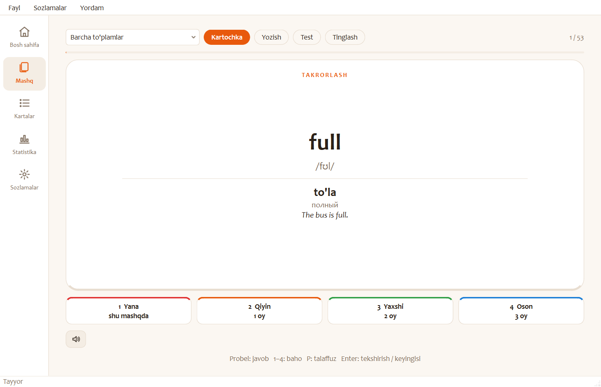
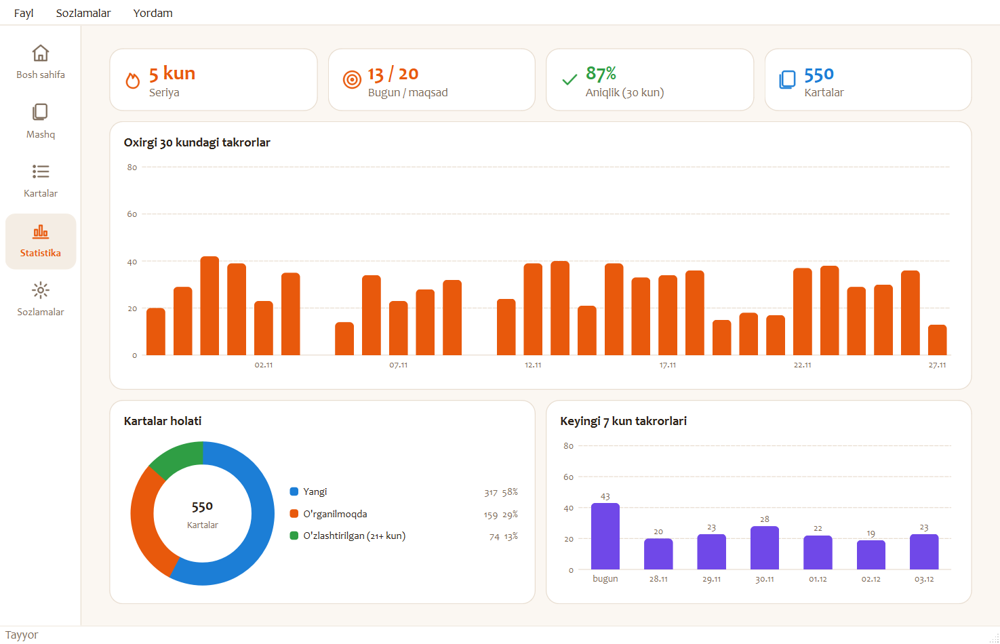
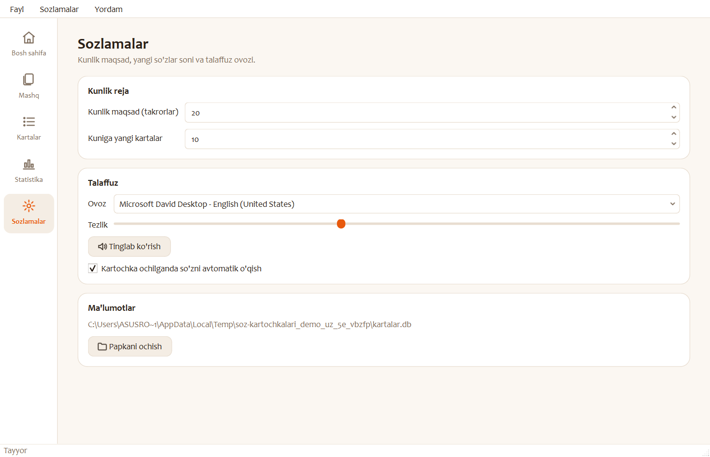

# Inglizcha so‘z kartochkalari: Uslubiy ko‘rsatma

Muallif: Hakimov Bahtiyorjon. Versiya: 1.0.2.

## 1. Uslubiy ko‘rsatmaning maqsadi va vazifalari

Ushbu uslubiy ko‘rsatma “Inglizcha so‘z kartochkalari” dasturidan oliy ta’lim muassasalari, kollej va texnikumlarda ingliz tili va mutaxassislik fanlari mashg‘ulotlarida, shuningdek talabalarning mustaqil ta’limini tashkil etishda foydalanish tartibini belgilaydi.

Maqsad – talabalarda ingliz tilidagi so‘z boyligini muntazam va rejali oshirish, oraliqli takrorlash usulidan ongli foydalanish va mutaxassislik atamalarini o‘zlashtirish ko‘nikmalarini shakllantirish.

Vazifalar:

- oraliqli takrorlash tamoyili va SM-2 algoritmining mohiyatini tushuntirish;
- to‘rt mashq turidan (kartochka, yozish, test, tinglash) maqsadga muvofiq foydalanishni o‘rgatish;
- o‘zini halol baholash madaniyatini shakllantirish;
- o‘qituvchi tomonidan mutaxassislik atamalari bo‘yicha to‘plam tayyorlash va tarqatish texnologiyasini ko‘rsatish;
- statistik ko‘rsatkichlar asosida o‘z o‘quv faoliyatini tahlil qilishni o‘rgatish.
Mashg‘ulotlar natijasida talaba so‘zlarni har kuni qisqa vaqt ajratib takrorlash odatini shakllantirishi, dasturning to‘rt mashq turidan foydalana olishi va o‘z natijalarini statistik ko‘rsatkichlar orqali kuzata olishi kutiladi.

Ko‘rsatma mashg‘ulot rejasi, amaliy topshiriqlar, baholash mezonlari va nazorat savollarini o‘z ichiga oladi. Undan bitta mashg‘ulot doirasida ham, semestr davomida mustaqil ta’limni tashkil etishda ham foydalanish mumkin: o‘qituvchi har bir mavzu uchun to‘plam tarqatadi, talabalar esa uni dastur yordamida muntazam takrorlab boradi.

## 2. Qo‘llash sohasi va maqsadli auditoriya

Dasturdan quyidagi fanlar va faoliyat turlarida foydalanish tavsiya etiladi:

- “Ingliz tili”, “Chet tili (ingliz)”, “Akademik ingliz tili” fanlari;
- xalqaro til sertifikatlariga tayyorgarlik kurslari (IELTS Academic to‘plami asosida);
- mutaxassislik fanlarida inglizcha atamalarni o‘rganish (masalan, “Kompyuter grafikasi” fani uchun tayyor to‘plam mavjud);
- “Pedagogik texnologiyalar” va “Ta’limda axborot texnologiyalari” fanlarida oraliqli takrorlash va raqamli o‘quv vositalari mavzulari;
- “Informatika” fanida ma’lumotlar bazasi, jadval fayllari formatlari (CSV, TSV, Excel) va algoritmlarni amaliy misolda o‘rganish;
- talabalarning mustaqil ta’limi, to‘garak mashg‘ulotlari va til klublari faoliyati.
Maqsadli auditoriya: bakalavriat talabalari, kollej va texnikum o‘quvchilari, ingliz tili va mutaxassislik fanlari o‘qituvchilari, shuningdek ingliz tilini mustaqil o‘rganayotgan mutaxassislar.

Kasbiy faoliyatda o‘qituvchi dasturdan o‘z fanining atamalar lug‘atini tayyorlash va talabalarga Excel fayli ko‘rinishida tarqatish uchun foydalanishi mumkin. Interfeys o‘zbek, rus va ingliz tillarida, kartalarda esa o‘zbekcha va ruscha tarjima berilgani sababli dastur turli ta’lim tillaridagi guruhlarda qo‘llanadi.

Dasturdan maktab va kollej o‘quvchilari bilan ham foydalanish mumkin: buning uchun o‘qituvchi o‘quv dasturidagi mavzular bo‘yicha qisqa (20–30 so‘zlik) to‘plamlar tayyorlaydi va kunlik maqsadni kichikroq belgilashni tavsiya qiladi.

## 3. O‘quv mashg‘ulotida foydalanish tartibi

Quyida 80 daqiqalik amaliy mashg‘ulot rejasi keltirilgan. Mashg‘ulot kompyuter sinfida o‘tkaziladi, har bir kompyuterda dastur, karnay yoki quloqchin bo‘ladi. O‘qituvchi oldindan quyidagilarni tayyorlaydi: dasturni har bir kompyuterga nusxalab, birinchi ishga tushirishni va inglizcha ovoz mavjudligini tekshiradi; mavzu bo‘yicha 30–40 ta so‘zdan iborat Excel jadvalini (“word”, “uz”, “ru”, “example” ustunlari bilan) tayyorlaydi.

**Tashkiliy qism (5 daqiqa).** Davomat, mavzu va maqsadni e’lon qilish, Excel faylini tarqatish.

**Nazariy qism (20 daqiqa).** Mashg‘ulotning nazariy qismi interaktiv tarzda o‘tkaziladi: o‘qituvchi talabalardan so‘zlarni qanday yodlashlarini so‘rab, ularning tajribasini oraliqli takrorlash g‘oyasi bilan solishtiradi. Unutish jarayoni va takrorlashning ahamiyati; oraliqli takrorlash g‘oyasi; SM-2 algoritmida baho va oraliq o‘rtasidagi bog‘liqlik; to‘rt tugmaning ma’nosi va o‘zini halol baholash; to‘rt mashq turining vazifasi (tanish, eslash, tanlash, eshitib yozish); kunlik maqsad va seriya. O‘qituvchi “Kartochka” rejimida bir nechta so‘zni namoyish qiladi va tugmalar ostidagi oraliqlarni izohlaydi.

**Amaliy qism (45 daqiqa).**

1. Excel faylini import qilib, yangi to‘plam yaratish va ustunlarni moslashtirish (7 daqiqa).
2. Yangi to‘plam bo‘yicha “Kartochka” rejimida mashq qilish (10 daqiqa).
3. Xuddi shu so‘zlarni “Test” rejimida mustahkamlash (8 daqiqa).
4. “Yozish” rejimida imloni tekshirish (8 daqiqa).
5. “Tinglash” rejimida eshitib yozish (7 daqiqa).
6. “Statistika” sahifasida natijalarni ko‘rib chiqish (5 daqiqa).
**Yakuniy qism (10 daqiqa).** Natijalarni muhokama qilish: qaysi so‘zlar ko‘proq “Yana” baholarini oldi va nima uchun; mashq turlari orasidagi farq; mustaqil ish uchun kunlik maqsad va yangi kartalar sonini birgalikda belgilash.

Mashg‘ulotning kutilgan natijasi: har bir talabada import qilingan mavzu to‘plami, to‘rt mashq turi bo‘yicha bajarilgan mashq va statistikada qayd etilgan bugungi takrorlar.

Amaliy qism davomida o‘qituvchi talabalarga individual yordam beradi: ustunlarni noto‘g‘ri moslashtirish, ovozning tanlanmaganligi, “Yana” tugmasidan haddan tashqari kam foydalanish kabi holatlarga e’tibor qaratadi. Juftlikda ishlaganda talabalar navbatma-navbat bir-birining “Tinglash” rejimidagi javoblarini tekshirishi mumkin.

*1-rasm. “Mashq” sahifasi, “Kartochka” rejimi: “full” so‘zi transkripsiya, o‘zbekcha va ruscha tarjima hamda misol bilan, pastda “Yana”, “Qiyin”, “Yaxshi”, “Oson” baholash tugmalari va keyingi takror oraliqlari*

## 4. Amaliy topshiriqlar

**1-topshiriq. Tayyor to‘plam bilan tanishish.** “300 ta eng ko‘p ishlatiladigan so‘z” to‘plamidan 10 ta yangi kartani “Kartochka” rejimida o‘rganing. Kutilgan natija: talaba har bir baho tugmasi ostidagi oraliqni izohlaydi va “Yana” deb baholangan karta shu mashq oxirida qaytishini kuzatadi.

**2-topshiriq. O‘z to‘plamingiz.** Mutaxassisligingiz bo‘yicha 20 ta atamani transkripsiya, o‘zbekcha va ruscha tarjima va misol bilan “Kartalar” sahifasida qo‘lda yoki Excel orqali qo‘shing. Kutilgan natija: yangi to‘plam “Bosh sahifa” da 20 ta yangi karta bilan ko‘rinadi.

**3-topshiriq. Import.** O‘qituvchi bergan CSV faylini import qiling, ustunlarni to‘g‘ri moslashtiring. So‘ng faylni ikkinchi marta import qiling. Kutilgan natija: ikkinchi importda barcha kartalar takroriy sifatida o‘tkazib yuboriladi.

**4-topshiriq. Yozish va imlo.** “Yozish” rejimida 15 ta so‘zni yozing, ataylab bitta so‘zda bitta harfni xato yozing. Kutilgan natija: dastur “Deyarli to‘g‘ri (imlo xatosi)” deb baholaydi, talaba bu baho qaysi tugmaga mos kelishini izohlaydi.

**5-topshiriq. Tinglash.** Talaffuz ovozi va tezligini sozlang va “Tinglash” rejimida 10 ta so‘zni yozing. Kutilgan natija: so‘zlar eshitiladi, qayta eshitish uchun P tugmasidan foydalaniladi.

**6-topshiriq. Kunlik reja.** O‘zingiz uchun kunlik maqsad va kuniga yangi kartalar sonini belgilang va bir hafta davomida rejaga amal qiling. Kutilgan natija: “Statistika” sahifasida seriya va oxirgi 30 kundagi takrorlar grafigi to‘ldiriladi.

**7-topshiriq. Statistik tahlil.** (Mustaqil ish bilan birga bajariladi.) Bir haftalik natijalaringiz asosida aniqlik foizi, kartalar holati va keyingi 7 kun prognozini tahlil qiling. Kutilgan natija: talaba qisqa yozma tahlil tayyorlaydi va keyingi hafta uchun rejasini asoslaydi.

**8-topshiriq. Eksport va almashish.** O‘z to‘plamingizni Excel va TSV formatlarida eksport qiling. Kutilgan natija: ikki fayl, Excel faylida barcha karta maydonlari ustunlarda joylashgan. Talaba Excel faylini guruhdoshiga beradi, u esa faylni o‘z dasturiga import qilib, to‘plam to‘g‘ri o‘tganini tekshiradi.

*2-rasm. “Statistika” sahifasi: seriya, bugungi takrorlar va maqsad, 30 kunlik aniqlik, oxirgi 30 kundagi takrorlar grafigi, kartalar holati va keyingi 7 kun takrorlari*

## 5. Baholash mezonlari

Amaliy mashg‘ulot va bir haftalik mustaqil ish natijasi 100 ballik shkala bo‘yicha baholanadi:

- o‘z to‘plamining sifatli tayyorlanishi (to‘g‘ri tarjima, transkripsiya, misol) – 20 ball;
- import va eksportning to‘g‘ri bajarilishi – 10 ball;
- to‘rt mashq turidan foydalanish – 20 ball;
- bir hafta davomida kunlik rejaga amal qilish (seriya va takrorlar grafigi asosida) – 20 ball;
- statistik tahlilning asoslanganligi – 15 ball;
- nazorat savollariga javob – 15 ball.
86–100 ball – “a’lo”, 71–85 ball – “yaxshi”, 55–70 ball – “qoniqarli”, 55 balldan kam – “qoniqarsiz”.

Baholashda statistikadagi raqamlarning o‘zi emas, balki talabaning muntazamligi va o‘z natijalarini tahlil qila olishi asosiy mezon hisoblanadi. O‘qituvchi talabaning bilimini dastur ko‘rsatkichlaridan tashqari og‘zaki so‘rov yoki qisqa yozma lug‘at diktanti bilan ham tekshiradi.

Bir haftalik mustaqil ishni baholashda o‘qituvchi talabadan “Statistika” sahifasining skrinshotini va o‘z to‘plamining Excel faylini so‘raydi. Natijalar talabaga izoh bilan yetkaziladi: to‘plamdagi xato tarjimalar, muntazamlikdagi uzilishlar va tahlildagi kamchiliklar ko‘rsatiladi.

## 6. Nazorat savollari

1. Oraliqli takrorlash usulining mohiyati nimada?
2. SM-2 algoritmida karta oralig‘i qanday o‘zgaradi va osonlik koeffitsiyenti nima?
3. “Yana”, “Qiyin”, “Yaxshi” va “Oson” tugmalari qanday holatda tanlanishi kerak?
4. Nima uchun o‘zini halol baholash takrorlash samaradorligi uchun muhim?
5. To‘rt mashq turi qanday ko‘nikmalarni rivojlantiradi?
6. Dastur yozma javobni qanday tekshiradi va “Deyarli to‘g‘ri” bahosi qachon beriladi?
7. Kunlik maqsad va kuniga yangi kartalar soni qanday tanlanishi kerak?
8. Seriya qanday hisoblanadi?
9. Qaysi kartalar “o‘zlashtirilgan” hisoblanadi?
10. Kartalarni qaysi formatlarda import va eksport qilish mumkin?

## 7. Mustaqil ish uchun tavsiyalar

- Har kuni bir vaqtda 15–20 daqiqa ajrating: muntazamlik bir martalik uzoq mashg‘ulotdan samaraliroq.
- Mashq oxirida chiqadigan to‘g‘ri javoblar foizini kuzatib boring: u doimiy past bo‘lsa, yangi kartalar sonini kamaytiring yoki avval “Kartochka” rejimida ko‘proq ishlang.
- Kuniga yangi kartalar sonini haddan tashqari ko‘paytirmang: yangi so‘zlar keyingi kunlarda takrorlar sonini oshiradi.
- Avval “Kartochka” rejimida tanishing, so‘ng “Yozish” va “Tinglash” rejimlarida mustahkamlang.
- O‘qiyotgan kitob yoki maqoladagi notanish so‘zlarni misol gap bilan birga o‘z to‘plamingizga qo‘shing.
- Mavzular bo‘yicha alohida to‘plamlar yarating (masalan, “Tarmoq texnologiyalari”, “Ma’lumotlar bazasi”): bu bir mavzuni maqsadli takrorlash imkonini beradi.
- Haftada bir marta “Statistika” sahifasini ko‘rib, aniqlik past bo‘lgan holatlarni tahlil qiling va “Keyingi 7 kun takrorlari” grafigiga qarab kelgusi haftadagi yuklamani rejalashtiring.
- Guruhdoshlaringiz bilan mutaxassislik atamalari to‘plamlarini Excel fayl ko‘rinishida almashing va tarjimalarni birgalikda tekshiring.
- Mustaqil ish natijasini to‘plamning Excel fayli va statistika sahifasining qisqa tahlili ko‘rinishida topshiring.
- So‘zni yodlashda misol gapni ovoz chiqarib o‘qing va o‘zingiz yangi gap tuzing: bu so‘zni faol lug‘atga o‘tkazishga yordam beradi.
- Imtihon oldidan yangi kartalar sonini kamaytirib, takrorlashga ko‘proq vaqt ajrating.
- Qiyin so‘zlar uchun kartaga rasm yoki o‘z misolingizni qo‘shing: ko‘rgazmali va shaxsiy misollar eslab qolishni yengillashtiradi.
- “Yana” tugmasidan qo‘rqmang: unutilgan so‘zni halol belgilash uni keyinroq yaxshiroq eslab qolishga olib keladi.

## 8. Xavfsizlik va axborot madaniyati qoidalari

- Dasturni faqat rasmiy GitHub sahifasidan yuklab oling va noma’lum manbalardagi nusxalardan foydalanmang.
- Boshqalardan olingan import fayllarini ishonchli manbadan kelganiga ishonch hosil qilgandan keyin oching; tarjimalarning to‘g‘riligini lug‘at orqali tekshiring.
- Kartalarga rasm qo‘shishda mualliflik huquqiga rioya qiling: o‘zingiz yaratgan yoki erkin litsenziyali rasmlardan foydalaning.
- Boshqa muallif tayyorlagan to‘plamni tarqatishda uning muallifini ko‘rsating.
- Tayyor to‘plamlar va o‘zingiz qo‘shgan tarjimalarni nufuzli lug‘atlar bilan solishtirib turing: dastur tarjimalarning to‘g‘riligini tekshirmaydi.
- Quloqchin bilan ishlaganda ovoz balandligini me’yorda saqlang va atrofdagilarga xalaqit bermang.
- Umumiy kompyuterda ishlaganda o‘z to‘plamingizni mashg‘ulot oxirida Excel faylga eksport qilib oling; kompyuterdagi o‘rganish tarixi keyingi foydalanuvchilarga ko‘rinishi mumkin.
- Kompyuter oldida uzoq vaqt ishlaganda ko‘z va qad-qomat gigiyenasiga rioya qiling, har 40–45 daqiqada qisqa tanaffus qiling. Qisqa va muntazam mashg‘ulotlar bu jihatdan ham uzoq bir martalik mashg‘ulotdan afzal.
- Kompyuter sinfida elektr va texnika xavfsizligi qoidalariga rioya qiling.

*3-rasm. “Sozlamalar” sahifasi: kunlik maqsad, kuniga yangi kartalar soni, talaffuz ovozi va tezligi, ma’lumotlar papkasi*

